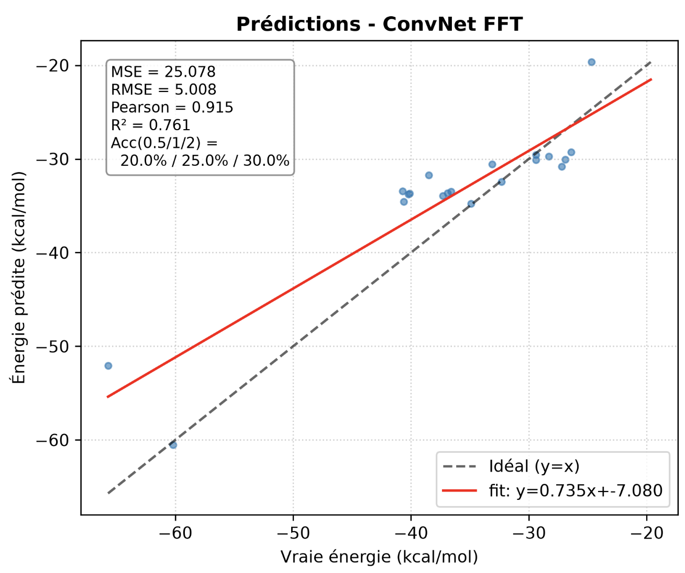
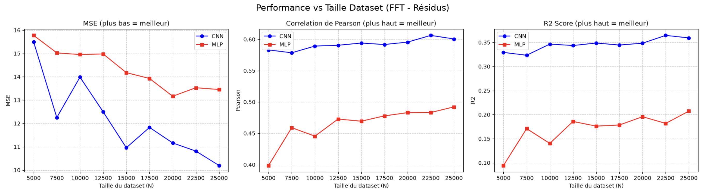
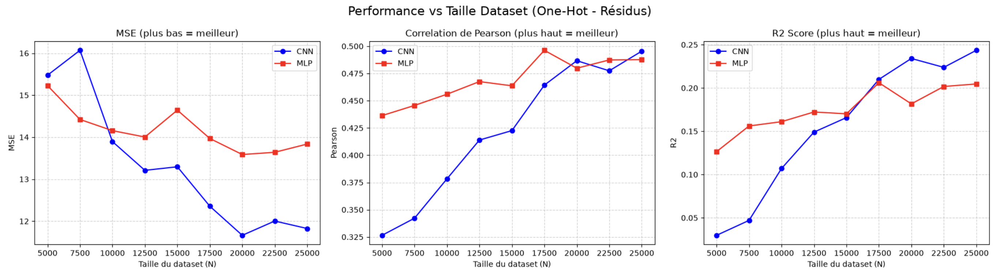
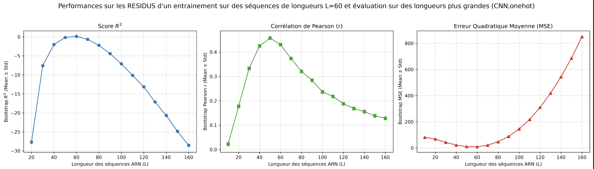
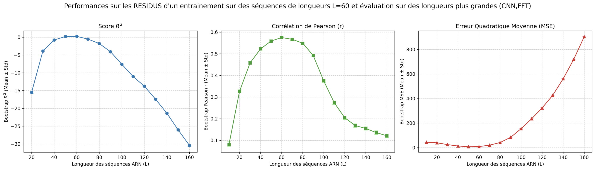
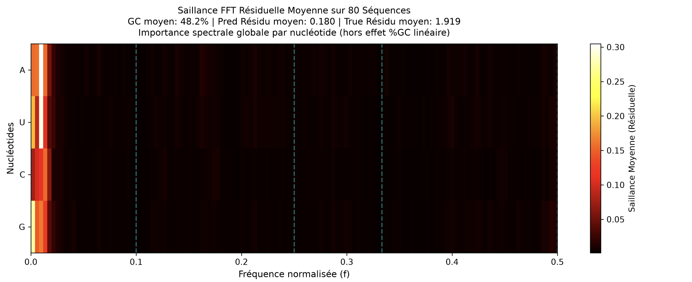
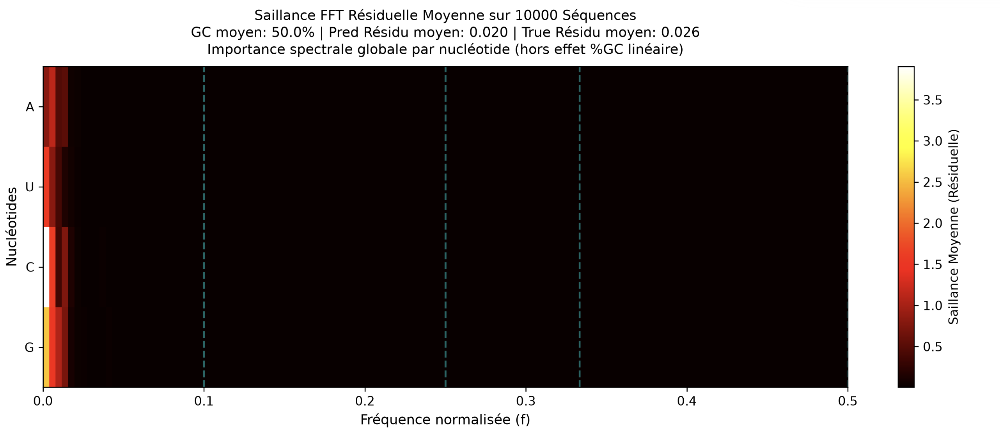

# RNA folding-energy prediction with spectral representations

**Research case study · École Polytechnique · Python / PyTorch / signal processing / computational biology**

> Can Fourier-domain features help compact neural networks learn sequence-dependent RNA folding-energy patterns — beyond the effects of sequence composition?

**Research showcase — no implementation or training data are published here.** This repository presents the questions, methodology, original figures, interpretation and limits of internship work. Model definitions, experiment scripts, checkpoints, raw sequences and internal reports are deliberately excluded.

## Research snapshot

| Focus | What was investigated |
| --- | --- |
| **Prediction target** | Minimum free energy (MFE) of RNA folding, **computed with ViennaRNA** (kcal/mol). It is a *computational target*, not an experimentally measured energy. |
| **Representations** | Nucleotide one-hot encoding; FFT-derived spectral features; related cross-spectral representations. |
| **Model families** | Compact 1D CNNs compared against MLP baselines and alternative inputs. |
| **Experimental design** | Controlled synthetic sequences; sequences reported as sourced from RNAcentral; analyses of dataset size, sequence length, GC-content effects and saliency. |
| **Selected small-sample result** | **R² = 0.761** in one original **80-training / 20-test** experiment reported as using RNAcentral sequences. This is not a replicated estimate or general-purpose benchmark. |

### Selected prediction example: RNAcentral-source experiment

*Original figure from the supplied results report (not rerun). Reported metrics: R² = 0.761, Pearson r = 0.915, RMSE = 5.008 kcal/mol; 20 test sequences. The energies on both axes are derived from ViennaRNA calculations, even when the input sequences are of natural origin. The archived code has an API-failure fallback to randomly generated sequences; without the underlying run logs, provenance of every sequence in this specific plot cannot be independently confirmed.*

## The experimental story

### 1. Two different sequence regimes — **not** interchangeable

| | Controlled synthetic | Naturally sourced RNA |
| --- | --- | --- |
| **Input sequences** | Random A/C/G/U sequences generated with controlled lengths / dataset sizes. | RNA sequences requested via the [RNAcentral](https://rnacentral.org/) API in one pipeline. Other experiments refer to a local cleaned benchmark CSV whose original provenance is not fully documented in the supplied materials. |
| **Labels** | Folding MFE computed by **ViennaRNA**. | Folding MFE computed by **ViennaRNA**, **not** wet-lab measured energy. |
| **Purpose** | Representation/model comparisons; size and length-shift stress tests. | Initial feasibility on non-random biological sequences and small-sample behavior. |
| **Limitation** | Artificial sequence distribution. | Small splits, incomplete dataset snapshot and potential selection/distribution effects. |

See [data provenance & caveats](docs/DATA_PROVENANCE.md).

### 2. Architecture matters as much as the representation

*Original synthetic-data study. The FFT + CNN configuration generally leads the FFT + MLP comparison in these reported residual-target metrics; performance changes with training set size.*

*One-hot is competitive, especially for the MLP in several low-data settings. These comparisons do **not** show that FFT always outperforms one-hot or that one architecture wins under every setup. Separate residual R² values should not be compared to raw-energy R².*

### 3. Generalization to unseen lengths: a mixed result

| One-hot + CNN | FFT + CNN |
| --- | --- |
|  |  |

*Original experiments train at length L = 60 and evaluate over shorter and longer synthetic sequences, with GC-adjusted residual metrics. FFT shows stronger Pearson correlation around several nearby lengths, but **both configurations fail badly under larger shifts**: residual R² becomes very negative and MSE rises. This is evidence of a limitation, not robust extrapolation.*

### 4. Is the model learning more than GC content?

GC percentage is a strong and easily exploitable sequence-composition signal. A useful model should ideally learn something beyond this shortcut.

The research compares energy prediction to a **GC-only baseline** and analyzes *residual energy* after removing the part accounted for by that baseline. The documented evaluation uses a linear GC baseline fitted on training data, rather than fitting it to the held-out targets. It then compares predictions and ground truth after subtraction of the **same** GC-only estimate. This probes performance beyond simple nucleotide composition; it is not a guarantee of mechanistic insight.

| Residual saliency — natural-source track | Residual saliency — synthetic track |
| --- | --- |
|  |  |

*Original averaged saliency maps. Low frequencies dominate the aggregate signal; interpretation at other frequencies is difficult because aggregation may cancel positive and negative contributions. These are exploratory explanations, not proof that the model has identified particular molecular interactions.*

### 5. What can spectral correlations tell us?

A separate theoretical study in the source materials derives how **zero-padded one-hot nucleotide indicators** can be combined with Fourier-domain auto/cross-correlations to count two-position nucleotide patterns at specified separations. This gives a possible route to interpreting what the spectral representation captures. It does **not** establish that the learned CNN uses all these motifs in the same way.

See [methods and interpretation](docs/METHODS_AND_INTERPRETATION.md).

## Conclusions — and what I would investigate next

**What worked in the reported experiments:** compact spectral CNNs showed promise, especially against FFT + MLP baselines in controlled studies; the small natural-sequence-source run achieved a promising prediction fit; residual analyses helped distinguish general composition signals from additional patterns.

**What remains unresolved:** small natural-source test sets, partial run provenance, computed (not experimentally measured) labels, sensitivity to sequence length, reliance on summary saliency plots and insufficient cross-seed validation. Spectral inputs are not automatically superior to one-hot.

**Next steps:** larger independently curated biological sequence datasets; repeated/length-stratified splits; stronger GC- and length-matched baselines; ablations of spectral channels and cross-correlations; uncertainty quantification; stricter evaluation on held-out families and sequence-length ranges.

## Technology & contributions

`Python` · `PyTorch` · `NumPy` · `SciPy` · `scikit-learn` · `FFT / signal processing` · `ViennaRNA` · `RNAcentral` · `CNN / MLP` · `regression evaluation` · `data visualization`

Work undertaken during a research internship at **École Polytechnique**. The supplied reports cover the dataset experiments, baseline comparisons, residual analysis, sequence-length stress tests and Fourier/motif interpretation. This showcase describes that work, without implying ownership of all laboratory code or datasets.

**[Data provenance](docs/DATA_PROVENANCE.md) · [Detailed experimental reading](docs/EXPERIMENTS_AND_LIMITATIONS.md) · [Methods and interpretation](docs/METHODS_AND_INTERPRETATION.md)**

### Code availability

The research implementation and original reports are **not distributed** because publication permissions have not been established. This repository is a technical presentation rather than a runnable reproduction. The included figures reproduce experiment outputs from the supplied private reports; **confirm permission from the laboratory before making those figures public**. No code license is granted.
